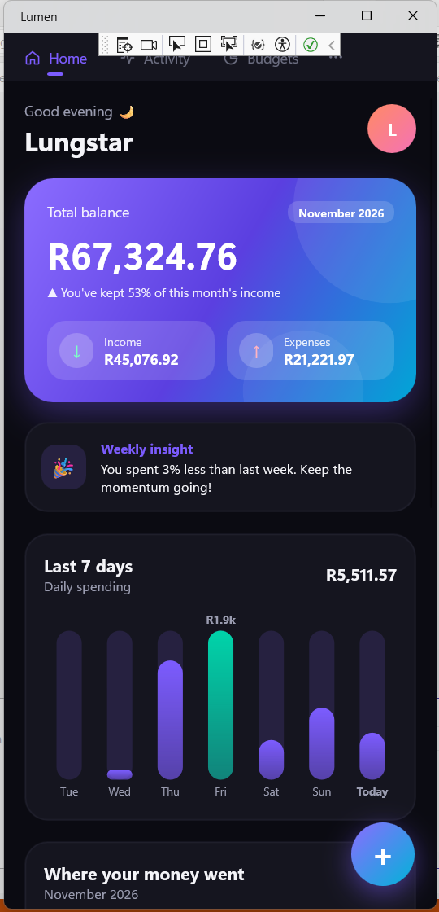
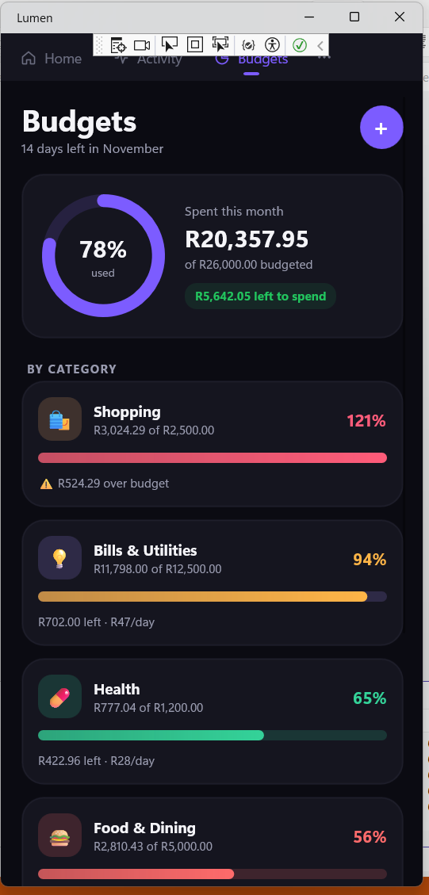
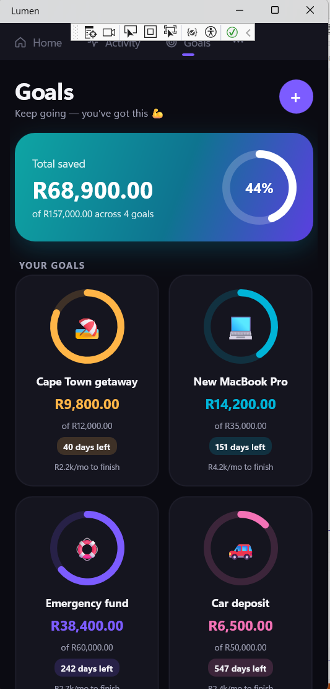
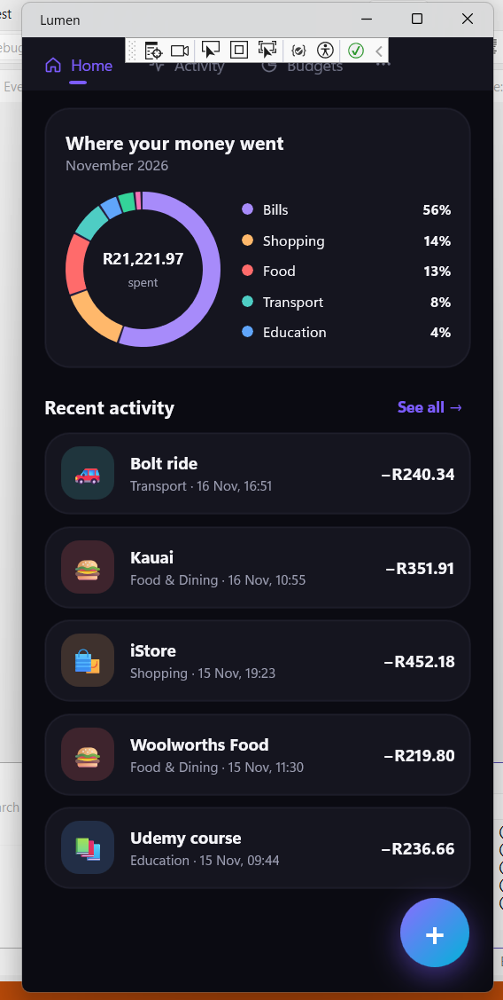
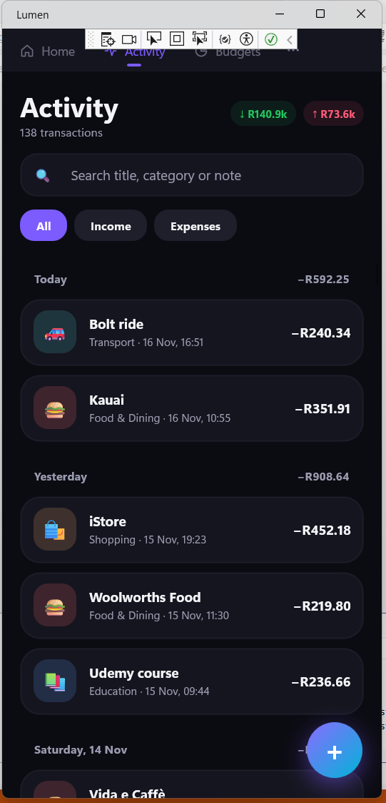
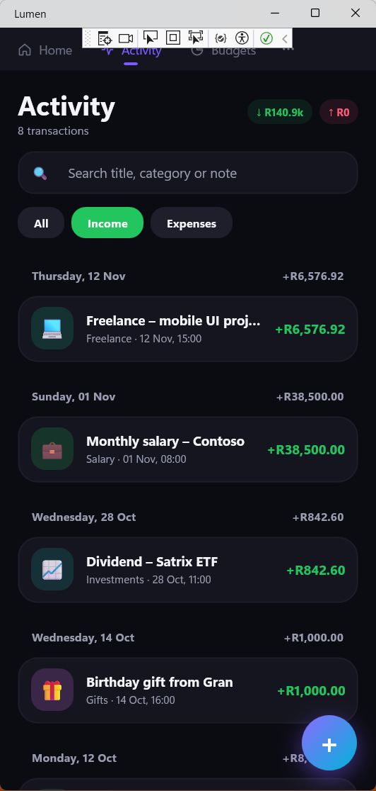
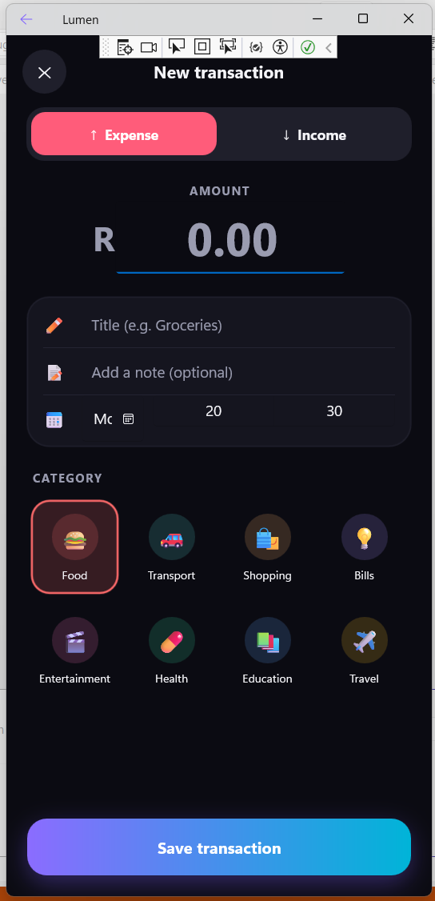
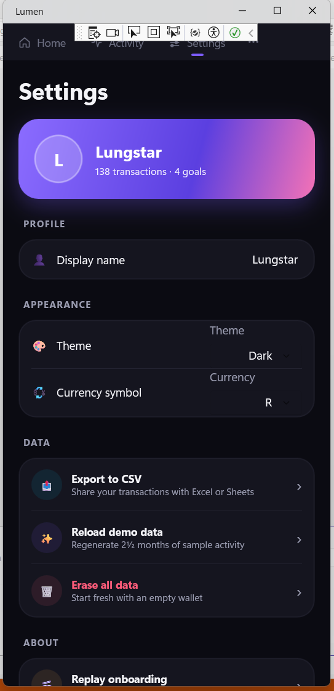

<div align="center">

# Lumen

**Personal finance, beautifully done.**

A modern, offline-first money app built with .NET MAUI. Track spending, stay within your budgets and grow your savings goals, all in a clean, glowing dark-mode design.

<br />


<br />


&nbsp;&nbsp;

&nbsp;&nbsp;


<br /><br />

[Screens](#screens) &nbsp;·&nbsp; [Highlights](#highlights) &nbsp;·&nbsp; [Under the hood](#under-the-hood) &nbsp;·&nbsp; [Getting started](#getting-started) &nbsp;·&nbsp; [Developer guide](docs/DEVELOPER_GUIDE.md)

</div>

<br />

## Highlights

<table>
<tr>
<td width="33%" valign="top">

**Designed with care**

Gradient hero cards, soft shadows, rounded surfaces and a consistent colour system, with light, dark and system themes switchable at runtime.

</td>
<td width="33%" valign="top">

**Hand-drawn charts**

Bar, donut, ring and progress charts drawn from scratch with `Microsoft.Maui.Graphics`. Every chart animates and adapts to the theme, without any charting library.

</td>
<td width="33%" valign="top">

**Private by default**

All data lives in a local SQLite database on the device. There are no accounts, no servers and no tracking.

</td>
</tr>
</table>

<br />

## Screens

### Home

<table>
<tr>
<td width="290" align="center">

</td>
<td valign="top">

The dashboard opens with a time-aware greeting and an avatar built from the user's initials.

**Balance card.** A purple-to-cyan gradient card shows the total balance, the current month and the share of this month's income that has been kept. Two inset panels break out monthly income and expenses.

**Weekly insight.** A short, generated message compares this week's spending with last week's, for example *"You spent 3% less than last week."*

**Last 7 days.** An animated bar chart of daily spending. The bars grow into place on load, the highest day is highlighted in teal with its value above it, and today is labelled in bold.

</td>
</tr>
</table>

<table>
<tr>
<td valign="top">

**Where your money went.** A donut chart breaks down the month's spending by category, with the total in the centre and a legend listing each category's share.

**Recent activity.** The five latest transactions, each with its category icon on a tinted tile. Tapping a row opens it for editing, and *See all* jumps to the Activity tab.

**Quick add.** The floating gradient button opens a new transaction from anywhere on the page.

</td>
<td width="290" align="center">

</td>
</tr>
</table>

### Activity

<table>
<tr>
<td align="center"><br /><sub>All transactions, grouped by day</sub></td>
<td align="center"><br /><sub>Filtered to income</sub></td>
</tr>
</table>

The full transaction history, grouped under *Today*, *Yesterday* and then full dates, with each day's net total alongside its heading.

- Summary pills in the header show total money in and money out for the current view.
- Search filters by title, category or note as you type.
- Filter chips switch between all transactions, income and expenses, each with its own selected colour.
- Swipe a row to delete it (with confirmation), or tap it to edit.
- Income is shown in green with a plus sign; expenses use a neutral minus sign.

### New transaction

<table>
<tr>
<td width="290" align="center">

</td>
<td valign="top">

A focused, full-screen editor designed for quick entry.

- **Expense / Income toggle.** A segmented control that turns coral or green and swaps the category list to match.
- **Amount.** A large input that receives focus automatically, shown beside the currency symbol.
- **Details.** Title, optional note, and date and time pickers.
- **Category grid.** The selected tile is outlined in its category colour, with a short spring animation and haptic feedback on tap.
- **Save.** Writes to SQLite and returns to the previous screen.

Opening an existing transaction uses the same screen in edit mode, with a delete action in the top corner.

</td>
</tr>
</table>

### Budgets

<table>
<tr>
<td valign="top">

**Monthly overview.** An animated progress ring shows how much of the total budget has been used, alongside the amount spent, the amount budgeted and how much is left to spend. The pill turns red when the month goes over budget.

**By category.** Each budget has its own card and gradient progress bar, which changes colour as spending approaches the limit:

| Usage | Bar colour |
|---|---|
| Under 80% | Category colour |
| 80% – 100% | Amber |
| Over 100% | Red, with an over-budget warning |

Each card also shows a daily allowance for the rest of the month, so the number is easy to act on. Cards are sorted with the most pressing budgets first.

New budgets are added from the header button; tapping a card lets you change its limit or remove it.

</td>
<td width="290" align="center">

</td>
</tr>
</table>

### Goals

<table>
<tr>
<td width="290" align="center">

</td>
<td valign="top">

**Total saved.** A teal-to-violet card shows the combined savings across all goals, with a progress ring for overall completion.

**Goal cards.** Goals are laid out in a two-column grid. Each card shows:

- a progress ring in the goal's own colour
- the amount saved and the target
- the days remaining until the deadline
- the monthly amount needed to finish on time

Tapping a goal offers to add money, withdraw or delete it. Reaching a target triggers a short celebration message.

</td>
</tr>
</table>

### Settings

<table>
<tr>
<td valign="top">

**Profile.** A gradient card with the user's initials and live stats, such as the number of transactions and goals. The display name can be edited in place and updates across the app.

**Appearance.** Theme (System, Light or Dark) and currency symbol (R, $, €, £, ₦, KSh, ₹, ¥). Both apply immediately throughout the app.

**Data.**
- *Export to CSV:* shares all transactions through the native share sheet, ready for Excel or Google Sheets.
- *Reload demo data:* regenerates two and a half months of realistic sample activity.
- *Erase all data:* clears everything for a fresh start.

**About.** Replay the onboarding, and see the app version, platform and technology stack.

</td>
<td width="290" align="center">

</td>
</tr>
</table>

### Onboarding

On first launch, a four-slide carousel on a deep violet gradient introduces the app: tracking, insights, budgets and goals. The final slide asks for the user's name so the dashboard can greet them personally. The tour can be replayed at any time from Settings.

<br />

## Under the hood

<table>
<tr>
<td valign="top" width="50%">

**Architecture**
- MVVM with CommunityToolkit.Mvvm source generators
- Dependency injection configured in `MauiProgram`
- Shell navigation with tabs, routes and query parameters (`editor?id=42`)
- Compiled bindings (`x:DataType`) throughout
- Async SQLite repository with lazy, thread-safe initialisation

</td>
<td valign="top" width="50%">

**UI and platform**
- Design tokens and `AppThemeBinding` for runtime theming
- Custom `GraphicsView` controls with bindable, animated properties
- `CollectionView` grouping, grid layouts, headers and empty states
- `SwipeView`, `RefreshView`, `CarouselView` and haptic feedback
- MAUI Essentials: Preferences, Share, FileSystem, AppInfo

</td>
</tr>
</table>

```
Lumen/
├── Charts/       Animated, hand-drawn chart controls
├── Models/       SQLite entities and the category catalogue
├── Services/     Database, settings, formatting and demo data
├── ViewModels/   One view model per screen
├── Views/        XAML pages and reusable components
└── Resources/    Colours, styles, icons and splash screen
```

<br />

## Getting started

**Requirements:** Visual Studio 2026 with the *.NET Multi-platform App UI development* workload.

```bash
git clone https://github.com/MawilaLungile/LumenApp.git
```

1. Open `Lumen.sln` in Visual Studio.
2. Select **Windows Machine** or an Android emulator as the target.
3. Press **F5**.

NuGet packages restore automatically, and the database is created and populated with demo data on first launch. No further setup is needed.

For a detailed look at the architecture, see the [developer guide](docs/DEVELOPER_GUIDE.md).

<br />

## Roadmap

- [ ] Biometric app lock
- [ ] Recurring transactions and subscriptions
- [ ] Budget alerts through local notifications
- [ ] Receipt scanning with the camera
- [ ] Optional cloud sync
- [ ] Unit tests for all view models

<br />

<div align="center">
<sub>Built with .NET MAUI</sub>
</div>
